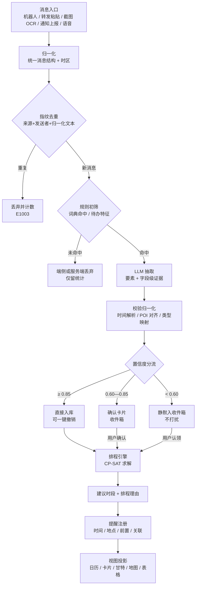
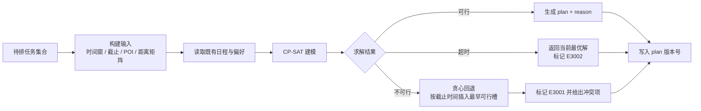
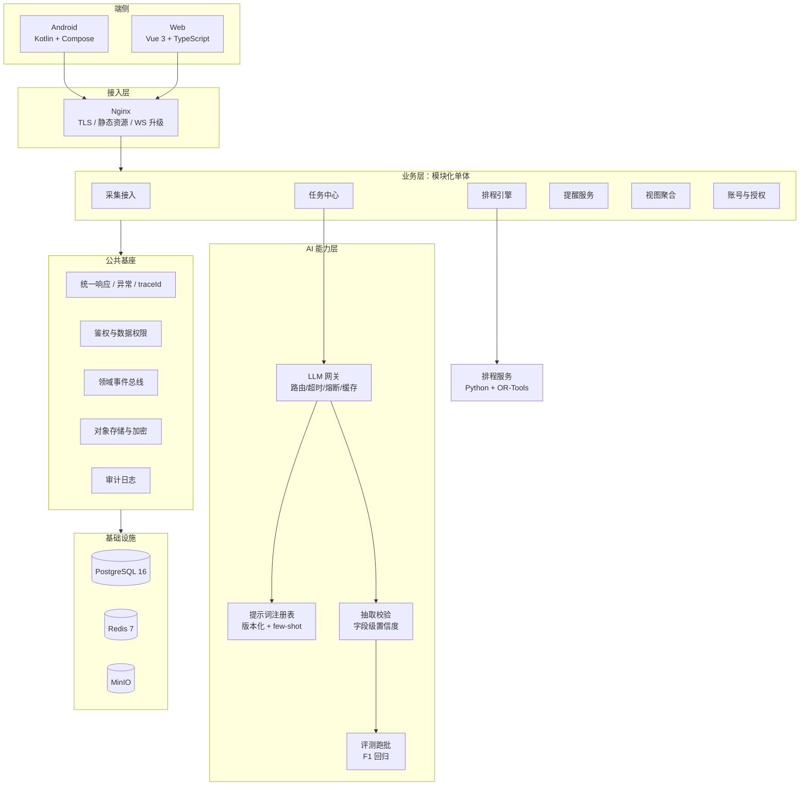
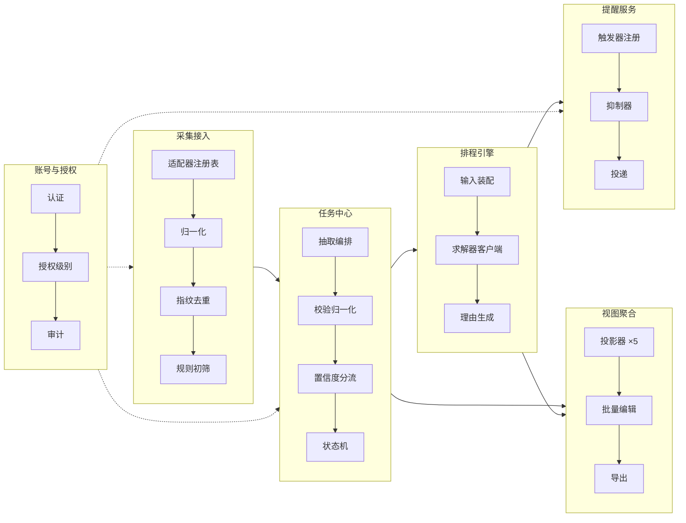
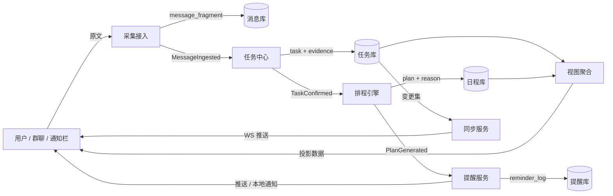
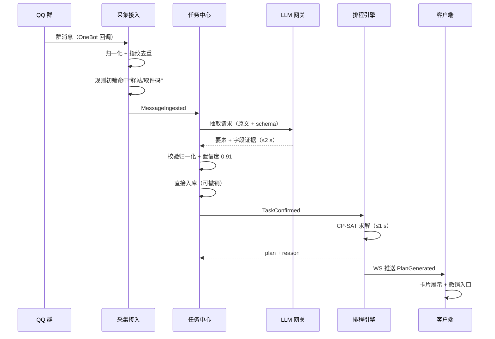
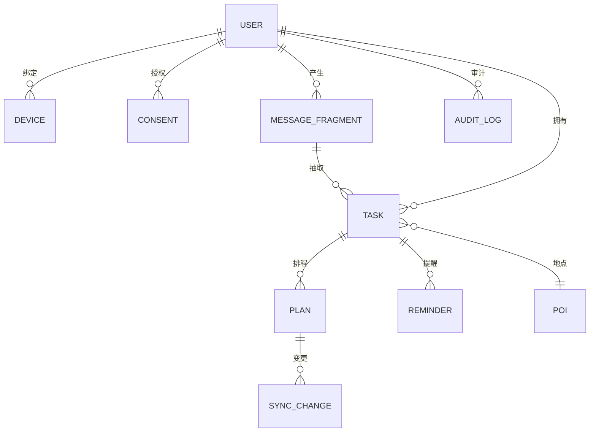
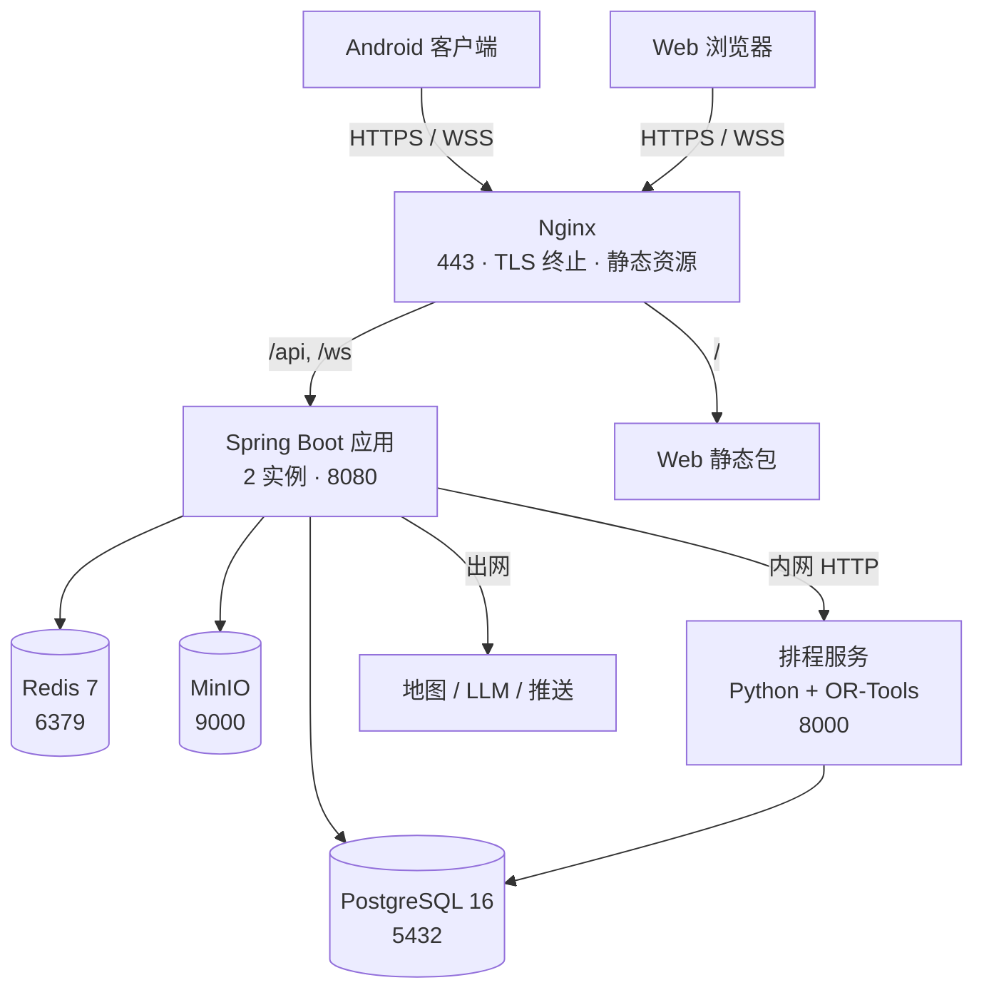
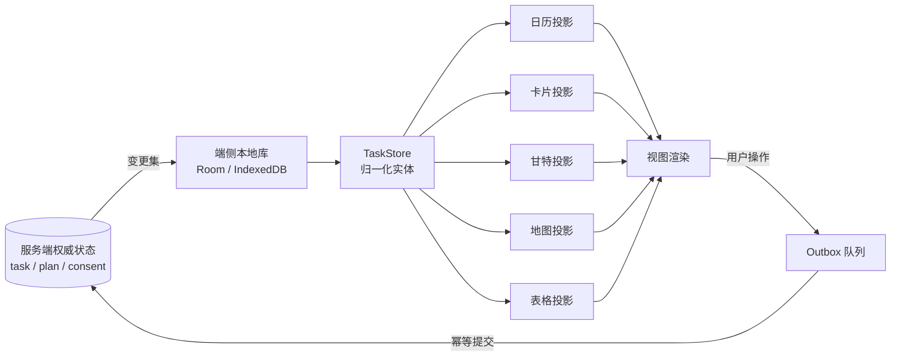

# 5 概要设计

> 本稿对应《附件5：项目开发文档》第 5 章，依据《需求说明书》V1.0 编写，覆盖 5.1—5.12。所有阈值、指标与《需求说明书》表 8、表 5—表 7 保持一致；出现冲突以需求说明书为准。
>
> 设计原则：**模块化单体 + 单一状态源 + 可降级链路**。初赛/区域赛阶段以一台云主机可完整运行为约束，不为"看起来像大厂"引入微服务与 K8s。

## 5.1 处理流程

### 5.1.1 主链路

一条消息从进入系统到变成可执行安排，经过五个阶段、三次判定：



三个判定点决定了系统的"打扰预算"：**去重**（同一件事只说一次）、**初筛**（不值得抽的不调模型）、**分流**（不确定的交给人）。

### 5.1.2 排程子流程



求解预算硬上限 1 s（对应表 8"排程计算耗时 ≤ 1 s / 20 个任务"）。超时不是错误，而是"够好的解"：CP-SAT 的 `max_time_in_seconds` 到点即返回 incumbent。

### 5.1.3 端侧处理流程

端侧承担"省流量、省隐私"的前置工作，服务端只接收命中待办特征的片段：

| 步骤 | Android 实现 | 说明 |
| --- | --- | --- |
| 通知读取 | `NotificationListenerService` | 需用户在系统设置中授予通知使用权 |
| 本地过滤 | 规则引擎（正则 + 词典 Trie） | 未命中的通知不上行，原文不出设备 |
| 脱敏 | 手机号/身份证/金额掩码 | 仅保留抽取所需片段 |
| 上行 | `POST /api/v1/ingest/notification` | 批量、压缩、失败入本地队列重试 |
| 截图/语音 | ML Kit OCR / 系统 ASR | 端侧转文本后按文本处理，不上传原始音视频 |

## 5.2 总体结构设计

### 5.2.1 分层结构



### 5.2.2 技术选型

| 层次 | 选型 | 理由 | 放弃的方案 |
| --- | --- | --- | --- |
| 服务端 | JDK 17 + Spring Boot 3.2 | 需求说明书已锁定 JDK 17；模块化单体用 Maven 多模块即可，无需注册中心 | Spring Cloud 全家桶：节点数少，运维成本高于收益 |
| 数据库 | PostgreSQL 16 | 抽取证据、变更集、排程理由都是半结构化数据，JSONB + GIN 索引直接可用；部分索引支持"待确认任务"这类软删除查询 | MySQL 8：JSON 能力够用但索引表达力弱，需额外拆表 |
| 缓存/事件 | Redis 7 | 幂等键、去重指纹、热点视图缓存、Stream 做轻量事件总线，一套组件覆盖四种用途 | Kafka：单机部署与运维成本不匹配 |
| 对象存储 | MinIO | S3 兼容，可本地部署，签名 URL 直接满足"按用户维度加密 + 签名访问" | 直接落本地磁盘：无法做签名与生命周期 |
| 排程求解 | OR-Tools CP-SAT（Python 服务） | 时间窗、不重叠、缓冲、可达性都是区间约束，CP-SAT 原生表达；Python 侧建模与调参最快 | Java 侧手写贪心：无法处理"少跑腿 + 集中 + 按截止"的多目标；Java OR-Tools 绑定可用但示例少 |
| 客户端 | Kotlin + Jetpack Compose | 通知监听、围栏、WorkManager 都是 Android 原生能力，跨端框架拿不到 | Flutter：通知监听需自写插件，收益为零 |
| Web | Vue 3 + TypeScript + Vite + Pinia | 五种视图都是数据投影，响应式状态管理直接对应"单一状态源" | 服务端渲染：无 SEO 需求 |
| 通信 | REST（OpenAPI 3）+ WebSocket（STOMP） | 与需求说明书 5.2 一致；STOMP 的订阅模型天然对应"按用户推送变更" | 纯轮询：多端同步延迟指标（≤1 s）达不到 |
| 构建部署 | Docker Compose + Nginx | 一台 4C8G 云主机跑全部服务，一条命令起环境 | K8s：初赛阶段无人维护 |

### 5.2.3 模块依赖规则

```
采集接入 ──▶ 任务中心 ──▶ 排程引擎 ──▶ 提醒服务
                │              │            │
                └──────────────┴────────────┘
                          ▼
                     视图聚合（只读）
账号与授权（被所有模块依赖，不反向依赖业务）
```

三条硬约束，由 ArchUnit 单元测试守护：

1. 业务模块之间只允许**单向调用 + 领域事件**，禁止反向依赖与跨模块直接访问对方数据表。
2. 视图聚合模块**只读**，不得触发状态变更；任何写操作必须回到所属模块。
3. `common-*` 与 `ai-*` 不得依赖任何业务模块（AI 能力层通过接口被调用，不认识"任务"这个业务概念，只认识"抽取请求/抽取结果"）。

构建门禁：JaCoCo 行覆盖率 ≥ 60%（对应需求"核心模块单元测试覆盖率不低于 60%"），低于阈值直接失败；ArchUnit 规则违反同样阻断构建。

## 5.3 功能设计

### 5.3.1 模块结构



### 5.3.2 采集接入

| 项 | 内容 |
| --- | --- |
| 职责 | 把五种异构入口收敛成一种消息结构；在进入 AI 之前完成清洗、去重、初筛 |
| 关键抽象 | `MessageSourceAdapter`：`supports(SourceType)` / `parse(RawPayload) → IngestedMessage` / `ack(MessageRef)` |
| 适配器实现 | `QqOneBotAdapter`（OneBot 11，WS 正向/反向 + HTTP 上报）、`WeChatILinkAdapter`（iLink Bot HTTP 回调）、`ManualUploadAdapter`（REST + multipart）、`OcrAdapter`（端侧已转文本，服务端只收文本）、`NotificationPushAdapter`（Android 批量上报） |
| 管道 | 归一化（统一字段 + 时区 + 发送者脱敏）→ 指纹（`sha256(source + sender + 归一化文本)`）→ 去重（Redis `SETNX` 5 分钟 + 库唯一索引兜底）→ 初筛（词典 Trie + 正则，命中即放行）→ 投递 `MessageIngested` |
| 附件 | 截图/语音按 `user_id/yyyyMM/` 前缀存 MinIO，AES-GCM 加密，元数据入库；删除任务时级联删除对象 |
| 失败处理 | 适配器断连指数退避重连；回调处理失败进 `ingest_retry` 表，最多 5 次；不阻塞其他消息源 |

### 5.3.3 任务中心

**抽取编排**：规则抽取（免费、快、可解释）先跑，模型抽取（贵、慢、覆盖广）兜底，两者结果按字段合并——规则命中的字段优先，模型补齐剩余字段。

**状态机**（`task.status`，非法迁移由状态机守卫直接抛 `IllegalTransitionException`）：

| 当前状态 | 允许迁移 | 触发者 |
| --- | --- | --- |
| CANDIDATE 候选 | PENDING_CONFIRM / CONFIRMED / CANCELLED | 分流器 / 用户 / 用户 |
| PENDING_CONFIRM 待确认 | CONFIRMED / CANCELLED / EXPIRED | 用户确认 / 用户删除 / 超时 7 天 |
| CONFIRMED 已确认 | SCHEDULED / DONE / CANCELLED | 排程成功 / 用户完成 / 用户取消 |
| SCHEDULED 已排程 | DONE / CANCELLED / EXPIRED | 用户完成 / 用户取消 / 过截止 |
| DONE / CANCELLED / EXPIRED | —（终态） | — |

**置信度计算**：字段级加权，而非模型自报总分。

$$\text{conf} = 0.30\,c_{time} + 0.25\,c_{place} + 0.25\,c_{type} + 0.20\,c_{title}$$

- `c_time`：时间表达式是否被解析成确定值（"周五下午"→ 确定；"有空再说"→ 0.2）
- `c_place`：地点是否对齐到唯一 POI（"菜鸟驿站"命中 3 个 → 0.5）
- `c_type`：类型映射是否唯一
- `c_title`：标题是否由原文连续片段生成（截断/改写降权）

阈值 0.85 / 0.60 与需求说明书表 5 一致，可在配置中心热更新。

**溯源与撤销**：`task.evidence` 存 JSONB，形如 `{"time": {"span": [12, 20], "text": "周五下午三点前"}}`，前端据此高亮原文。撤销走 `POST /tasks/{id}/undo`，5 分钟内有效，写入 `task_revision` 反向变更。

### 5.3.4 排程引擎

**输入**：待排任务、既有日程（系统日历只读）、POI 距离矩阵（步行/骑行两种速度）、用户偏好（可排时段、缓冲、集中度、目标权重）。

**决策变量**：每个任务一个可选区间 `start_i`、`size_i`（按类型默认时长：取件 10 min、缴费 5 min、预约 30 min、归还 10 min、约定 60 min），以及一个"放到第几天"的整数变量，允许跨日回退。

**约束**：

| 约束 | 表达 |
| --- | --- |
| 时间窗 | `window_start ≤ start_i`，`start_i + size_i ≤ window_end` |
| 截止 | `start_i + size_i ≤ deadline_i`（软约束，违反计入迟到量 L） |
| 不重叠 | 同一用户所有区间 `NoOverlap` |
| 缓冲 | 相邻任务间 `buffer_minutes`（默认 10） |
| 地点可达 | 同一天相邻任务按 POI 距离矩阵插入步行时间 |
| 开放时段 | POI 的 `open_start/open_end` 约束区间 |
| 每日上限 | 单日任务数 ≤ 30（对应需求"单日可排任务 30 条以内"） |

**目标**（加权和，权重来自用户偏好）：

$$\min\; w_1 \cdot \frac{T}{T_0} + w_2 \cdot \frac{S}{S_0} + w_3 \cdot \frac{L}{L_0}$$

$T$ 为总旅行时间（少跑腿），$S$ 为每日时间跨度之和（集中），$L$ 为迟到量（按截止）；$T_0,S_0,L_0$ 为归一化基准，避免量纲互相淹没。默认 $w=(0.4, 0.3, 0.3)$。

**理由生成**：模板 + 事实填充，不调用模型（保证 1 s 内返回且可复现）。例："放在 16:40，因为你在 16:30 下课、驿站 17:00 关门，且与 15:00 的打印店同方向，可一次走完。"

### 5.3.5 提醒服务

| 触发类型 | 判定位置 | 实现 |
| --- | --- | --- |
| 时间 | 服务端 | Redis ZSET 延迟队列，到点投递；断线由扫描任务补发 |
| 地点 | 端侧 | `GeofencingClient` 注册围栏（默认半径 200 m），进入即本地通知 |
| 前置条件 | 服务端 | 依赖任务状态变更事件触发 |
| 关联 | 服务端 | 关联任务确认/取消时联动 |

**抑制器**（对应需求"不过度打扰"）：

1. 同一任务 24 h 内最多 2 次；
2. 免打扰时段（默认 23:00—07:00）只做日历标记，不发通知；
3. 连续忽略 3 次降级为仅日历标记；
4. 同一地点多个任务合并为一条提醒（取最近截止的那条作标题，其余折叠）。

**端侧围栏配额**：Android 单个应用同时最多 100 个围栏，因此只注册"未来 24 h 内、且距当前位置 3 km 内"的任务；其余由服务端定时提醒兜底。

### 5.3.6 视图聚合

五种视图是同一份 `task + plan` 状态的五个投影函数，切换视图不改变数据、不丢失筛选：

| 投影 | 输入 | 交互 |
| --- | --- | --- |
| 日历 | plan_start/plan_end + 既有日程 | 拖拽改期、拉伸改时长 → 生成变更集 |
| 卡片 | 收件箱（CANDIDATE/PENDING_CONFIRM） | 左右滑：确认 / 忽略；一次最多 3 张 |
| 甘特 | plan + 依赖关系 | 拖动条、调整依赖 |
| 地图 | place_id + 聚合半径 | 点击聚合点展开，按路线排序 |
| 表格 | 全字段 | 行内编辑、多选、导出 CSV / ICS |

导出 ICS 直接复用 `plan` 的起止时间，不额外落库。

### 5.3.7 账号与授权

**授权级别**（累进式，默认 L1）：

| 级别 | 含义 | 开启后可采集 | 撤回动作 |
| --- | --- | --- | --- |
| L0 | 关闭 | 无 | — |
| L1 | 手动投递 | 转发、粘贴、截图、语音 | 停止接收，保留已有任务 |
| L2 | 机器人会话 | L1 + QQ/微信群与单聊 | 断开适配器，群白名单清空 |
| L3 | 端侧通知感知 | L2 + 白名单应用通知 | 端侧停止上报并清空本地缓冲 |
| L4 | 附件与语音 | L3 + 截图/语音附件加密存储 | 删除未关联附件 |

撤回即时生效：先断采集（同步），再清理未确认候选（异步，10 s 内完成），全过程写审计。

## 5.4 数据流转设计

### 5.4.1 数据流图



### 5.4.2 领域事件

| 事件 | 生产者 | 消费者 | 关键载荷 |
| --- | --- | --- | --- |
| `MessageIngested` | 采集接入 | 任务中心 | messageId, userId, sourceType, text, fingerprint |
| `TaskExtracted` | 任务中心 | 视图聚合 | taskId, confidence, status |
| `TaskConfirmed` | 任务中心 | 排程引擎、视图聚合 | taskId, taskVersion |
| `PlanGenerated` | 排程引擎 | 提醒服务、视图聚合 | planId, taskId, start, end, reason |
| `PlanConflicted` | 排程引擎 | 任务中心、视图聚合 | taskId, conflictTaskIds |
| `ReminderFired` | 提醒服务 | 视图聚合、审计 | reminderId, taskId, channel, result |
| `ConsentChanged` | 账号与授权 | 采集接入、任务中心 | userId, fromLevel, toLevel |
| `SyncChanged` | 各写模块 | 同步服务 | entity, entityId, field, old, new, version |

事件走 Redis Stream，消费组保证"至少一次"；消费者按 `eventId` 幂等去重。

### 5.4.3 UC-01 时序



## 5.5 用户界面设计

### 5.5.1 信息架构

```
收件箱 ──┬── 卡片流（确认/忽略）
         └── 任务详情（原文高亮 · 字段编辑 · 溯源 · 撤销）

日历 ────┬── 日 / 周 / 月
         └── 拖拽改期

地图 ────┬── 聚合点
         └── 顺路排序

甘特 ────┬── 时间条
         └── 依赖连线

表格 ────┬── 行内编辑
         └── 导出 CSV / ICS

设置 ────┬── 授权级别 L0—L4
         └── 白名单应用 / 群 / 免打扰时段
```

### 5.5.2 关键界面

```svg
<svg viewBox="0 0 1000 620" xmlns="http://www.w3.org/2000/svg" font-family="system-ui, sans-serif" font-size="13">
  <g fill="none" stroke="currentColor" stroke-width="1.5">
    <!-- 手机 -->
    <rect x="20" y="20" width="300" height="580" rx="22"/>
    <line x1="20" y1="86" x2="320" y2="86"/>
    <line x1="20" y1="520" x2="320" y2="520"/>
    <!-- 卡片 1 -->
    <rect x="40" y="106" width="260" height="118" rx="10"/>
    <line x1="40" y1="160" x2="300" y2="160" stroke-dasharray="3 3" opacity="0.5"/>
    <line x1="40" y1="190" x2="300" y2="190" stroke-dasharray="3 3" opacity="0.5"/>
    <!-- 卡片 2 -->
    <rect x="40" y="238" width="260" height="118" rx="10" opacity="0.7"/>
    <line x1="40" y1="294" x2="300" y2="294" stroke-dasharray="3 3" opacity="0.4"/>
    <line x1="40" y1="324" x2="300" y2="324" stroke-dasharray="3 3" opacity="0.4"/>
    <!-- 卡片 3 -->
    <rect x="40" y="370" width="260" height="118" rx="10" opacity="0.4"/>
    <!-- 底部导航 -->
    <line x1="95" y1="520" x2="95" y2="600"/>
    <line x1="170" y1="520" x2="170" y2="600"/>
    <line x1="245" y1="520" x2="245" y2="600"/>
    <!-- Web -->
    <rect x="360" y="20" width="620" height="580" rx="8"/>
    <line x1="360" y1="64" x2="980" y2="64"/>
    <line x1="470" y1="64" x2="470" y2="600"/>
    <line x1="800" y1="64" x2="800" y2="600"/>
    <!-- 日历网格 -->
    <line x1="470" y1="140" x2="800" y2="140"/>
    <line x1="470" y1="216" x2="800" y2="216"/>
    <line x1="470" y1="292" x2="800" y2="292"/>
    <line x1="470" y1="368" x2="800" y2="368"/>
    <line x1="470" y1="444" x2="800" y2="444"/>
    <line x1="470" y1="520" x2="800" y2="520"/>
    <line x1="552" y1="64" x2="552" y2="600"/>
    <line x1="634" y1="64" x2="634" y2="600"/>
    <line x1="716" y1="64" x2="716" y2="600"/>
    <!-- 甘特条 -->
    <rect x="486" y="160" width="120" height="18" rx="4" fill="currentColor" opacity="0.18"/>
    <rect x="640" y="236" width="90" height="18" rx="4" fill="currentColor" opacity="0.18"/>
    <rect x="520" y="312" width="150" height="18" rx="4" fill="currentColor" opacity="0.18"/>
    <!-- 详情面板 -->
    <rect x="820" y="88" width="140" height="90" rx="6" opacity="0.6"/>
    <rect x="820" y="196" width="140" height="150" rx="6" opacity="0.6"/>
    <rect x="820" y="364" width="140" height="40" rx="6" opacity="0.6"/>
  </g>
  <g fill="currentColor">
    <text x="40" y="60" font-weight="600">收件箱 · 3</text>
    <text x="40" y="130" font-weight="600">取快递（菜鸟驿站）</text>
    <text x="40" y="148" opacity="0.65">今天 16:40 · 步行 6 分钟</text>
    <text x="40" y="176" opacity="0.65">置信度 0.91 · 来源：班级群</text>
    <text x="40" y="208" opacity="0.5">[确认]  [改期]  [撤销]</text>
    <text x="40" y="262" font-weight="600">缴电费（宿舍 3 栋）</text>
    <text x="40" y="282" opacity="0.65">明天 09:00 · 截止 11-20</text>
    <text x="40" y="308" opacity="0.65">置信度 0.72 · 来源：短信</text>
    <text x="40" y="340" opacity="0.5">[确认]  [忽略]</text>
    <text x="40" y="394" font-weight="600">还书（图书馆）</text>
    <text x="40" y="411" opacity="0.65">时间待定 · 截止 11-25</text>
    <text x="60" y="556" opacity="0.75">收件箱</text>
    <text x="142" y="556" opacity="0.75">日历</text>
    <text x="222" y="556" opacity="0.75">地图</text>

    <text x="380" y="46" font-weight="600">拾零 · 本周</text>
    <text x="490" y="46" opacity="0.6">日</text>
    <text x="572" y="46" opacity="0.6">一</text>
    <text x="654" y="46" opacity="0.6">二</text>
    <text x="736" y="46" opacity="0.6">三</text>
    <text x="380" y="100" opacity="0.6">视图</text>
    <text x="380" y="126" opacity="0.6">日历</text>
    <text x="380" y="152" opacity="0.6">卡片</text>
    <text x="380" y="178" opacity="0.6">甘特</text>
    <text x="380" y="204" opacity="0.6">地图</text>
    <text x="380" y="230" opacity="0.6">表格</text>
    <text x="380" y="290" opacity="0.6">筛选</text>
    <text x="380" y="316" opacity="0.6">未完成</text>
    <text x="380" y="342" opacity="0.6">本周</text>
    <text x="820" y="112" font-weight="600">任务详情</text>
    <text x="832" y="136" opacity="0.65">原文高亮</text>
    <text x="832" y="156" opacity="0.65">字段编辑</text>
    <text x="820" y="220" font-weight="600">排程理由</text>
    <text x="832" y="244" opacity="0.65">16:30 下课</text>
    <text x="832" y="264" opacity="0.65">驿站 17:00 关门</text>
    <text x="832" y="284" opacity="0.65">与打印店同向</text>
    <text x="820" y="392" opacity="0.75">[导出 ICS]</text>
  </g>
</svg>
```

### 5.5.3 端侧分工与交互约束

| 能力 | Android | Web | 依据 |
| --- | --- | --- | --- |
| 采集（通知/截图/语音） | ✅ | — | 系统能力仅在端侧 |
| 到地提醒 | ✅ | — | 围栏与定位 |
| 日历/甘特/表格整理 | 简化版 | ✅ | 大屏与批量操作 |
| 批量编辑与导出 | — | ✅ | 需求 5.5 |
| 撤销与溯源 | ✅ | ✅ | 任何自动化结果都必须可撤销 |

交互硬约束：**任何自动结果必须带撤销入口**；**任务详情必须能一键跳到原文并高亮证据片段**；**单次最多 3 张确认卡片**（对应表 6 设计规则）。

## 5.6 数据结构设计

### 5.6.1 实体关系



### 5.6.2 核心表

字段命名与《需求说明书》表 3 数据词典一致（`source_id`、`fingerprint`、`confidence`、`consent_level` 等直接沿用）。

**message_fragment**

| 字段 | 类型 | 约束 | 说明 |
| --- | --- | --- | --- |
| id | uuid | PK | — |
| user_id | uuid | FK, idx | 归属用户 |
| source_id | varchar(16) | not null | QQ / WECHAT / MANUAL / NOTIFY |
| conversation_id | varchar(64) | idx | 会话标识（群号/单聊） |
| sender_id | varchar(64) | — | 发送者（脱敏后） |
| text | text | ≤500 字 | 原文片段 |
| fingerprint | char(64) | unique(user_id, fingerprint) | 去重指纹 |
| attachment_key | varchar(255) | — | MinIO 对象键 |
| captured_at | timestamptz | idx | 采集时间 |
| created_at | timestamptz | default now() | — |

```sql
CREATE TABLE message_fragment (
  id              uuid PRIMARY KEY,
  user_id         uuid NOT NULL REFERENCES app_user(id),
  source_id       varchar(16) NOT NULL,
  conversation_id varchar(64),
  sender_id       varchar(64),
  text            text NOT NULL CHECK (char_length(text) <= 500),
  fingerprint     char(64) NOT NULL,
  attachment_key  varchar(255),
  captured_at     timestamptz NOT NULL,
  created_at      timestamptz NOT NULL DEFAULT now(),
  CONSTRAINT uq_fragment_fp UNIQUE (user_id, fingerprint)
);
CREATE INDEX idx_fragment_user_time ON message_fragment (user_id, captured_at DESC);
```

**task**

| 字段 | 类型 | 约束 | 说明 |
| --- | --- | --- | --- |
| id | uuid | PK | — |
| user_id | uuid | FK, idx | — |
| source_message_id | uuid | FK, idx | 溯源 |
| title | varchar(60) | not null | ≤60 字 |
| type | varchar(16) | check in (取件,缴费,预约,归还,约定) | 枚举 |
| window_start / window_end | timestamptz | 可空 | 时间窗 |
| deadline | timestamptz | 可空 | 截止 |
| place_id | uuid | FK poi, 可空 | 地点 |
| confidence | numeric(3,2) | 0—1，两位小数 | 置信度 |
| status | varchar(16) | 状态机守卫 | 见 5.3.3 |
| evidence | jsonb | — | 字段级证据 span |
| version | int | 乐观锁 | 同步用 |
| created_at / updated_at | timestamptz | — | — |

```sql
CREATE TABLE task (
  id                uuid PRIMARY KEY,
  user_id           uuid NOT NULL REFERENCES app_user(id),
  source_message_id uuid REFERENCES message_fragment(id),
  title             varchar(60) NOT NULL,
  type              varchar(16) NOT NULL,
  window_start      timestamptz,
  window_end        timestamptz,
  deadline          timestamptz,
  place_id          uuid REFERENCES poi(id),
  confidence        numeric(3,2) NOT NULL CHECK (confidence BETWEEN 0 AND 1),
  status            varchar(16) NOT NULL,
  evidence          jsonb NOT NULL DEFAULT '{}'::jsonb,
  version           int NOT NULL DEFAULT 0,
  created_at        timestamptz NOT NULL DEFAULT now(),
  updated_at        timestamptz NOT NULL DEFAULT now(),
  CONSTRAINT ck_task_type CHECK (type IN ('取件','缴费','预约','归还','约定')),
  CONSTRAINT ck_task_status CHECK (status IN ('CANDIDATE','PENDING_CONFIRM','CONFIRMED','SCHEDULED','DONE','CANCELLED','EXPIRED'))
);
-- 收件箱查询：只扫未终态
CREATE INDEX idx_task_inbox ON task (user_id, status, created_at DESC)
  WHERE status IN ('CANDIDATE','PENDING_CONFIRM');
CREATE INDEX idx_task_deadline ON task (user_id, deadline) WHERE deadline IS NOT NULL;
```

**plan**

| 字段 | 类型 | 说明 |
| --- | --- | --- |
| id | uuid | PK |
| task_id | uuid | FK，一任务多版本 |
| plan_start / plan_end | timestamptz | 建议时段，不与既有日程重叠 |
| place_id | uuid | 排程地点 |
| reason | varchar(80) | 排程理由，≤80 字 |
| solver | varchar(16) | CP_SAT / GREEDY |
| objective | jsonb | 各目标分量值 |
| version | int | 版本号 |
| superseded_by | uuid | 被新版本取代 |

**reminder**

| 字段 | 类型 | 说明 |
| --- | --- | --- |
| id | uuid | PK |
| task_id | uuid | FK |
| trigger_type | varchar(16) | TIME / GEOFENCE / PRECONDITION / RELATED |
| fire_at | timestamptz | 计划触发时间（地点触发为空） |
| channel | varchar(16) | PUSH / LOCAL / CALENDAR_ONLY |
| result | varchar(16) | SENT / SUPPRESSED / FAILED / IGNORED / DONE |
| fired_at | timestamptz | 实际触发 |

**其余表**（字段从略，仅列职责与关键列）：

| 表 | 职责 | 关键列 |
| --- | --- | --- |
| `app_user` | 账号 | id, phone, nickname, tz, created_at |
| `device` | 多设备 | id, user_id, platform, push_token, last_seen_at |
| `consent` | 授权 | user_id, level, scope(jsonb), granted_at, revoked_at |
| `poi` | 地点 | id, campus, name, lat, lng, open_start, open_end, aliases |
| `lexicon_entry` | 校园词典 | word, synonyms, type, weight |
| `sync_change` | 变更集 | entity, entity_id, field, old_value, new_value, device_id, version, server_ts |
| `sync_conflict` | 冲突留存 | entity, entity_id, left_value, right_value, resolved_by |
| `audit_log` | 审计 | actor, action, target, before, after, ip, ua, created_at |
| `eval_sample` | 评测语料 | text, labels(jsonb), split, source |
| `task_revision` | 撤销/历史 | task_id, patch(jsonb), undone_at |

### 5.6.3 存储与保留策略

| 数据 | 保留 | 依据 |
| --- | --- | --- |
| 消息原文 | 180 天，可配置 | 隐私最小必要 |
| 附件 | 与任务同生命周期，删除任务即删对象 | 需求"一键删除" |
| 变更集 | 30 天（超出后靠全量快照） | 同步窗口 |
| 审计日志 | 1 年 | 可追溯 |
| 评测语料 | 长期（脱敏） | 回归评测 |

## 5.7 接口设计

### 5.7.1 外部接口

**统一信封**（与需求说明书 5.2 一致）：`{code, message, data, traceId}`，`code="0"` 表示成功；HTTP 状态码表达传输语义，业务错误一律 200 + 错误码，避免客户端被 4xx 分支淹没。

| 方法 | 路径 | 说明 | 幂等 |
| --- | --- | --- | --- |
| POST | `/api/v1/auth/login` | 登录换取 JWT | — |
| POST | `/api/v1/auth/refresh` | 刷新令牌 | — |
| GET | `/api/v1/consent` | 查询当前授权级别 | — |
| PUT | `/api/v1/consent` | 调整授权级别（L0—L4） | 幂等 |
| POST | `/api/v1/ingest/manual` | 手动投递（文本/图片/语音转写） | `Idempotency-Key` |
| POST | `/api/v1/ingest/notification` | 端侧通知批量上报 | `Idempotency-Key` |
| POST | `/api/v1/ingest/bot/qq` | OneBot 回调入口 | 按 message_id 去重 |
| POST | `/api/v1/ingest/bot/wechat` | iLink 回调入口 | 按 msgid 去重 |
| GET | `/api/v1/tasks` | 列表（状态/时间/类型筛选、游标分页） | — |
| GET | `/api/v1/tasks/{id}` | 详情（含 evidence 与原文） | — |
| PATCH | `/api/v1/tasks/{id}` | 编辑字段（带 If-Match 版本号） | 乐观锁 |
| POST | `/api/v1/tasks/{id}/confirm` | 确认入库 | 幂等 |
| POST | `/api/v1/tasks/{id}/cancel` | 取消 | 幂等 |
| POST | `/api/v1/tasks/{id}/undo` | 撤销自动入库 | 5 分钟内有效 |
| POST | `/api/v1/tasks/batch` | 批量确认/忽略/改期 | `Idempotency-Key` |
| GET | `/api/v1/plans?from=&to=` | 日程区间查询 | — |
| POST | `/api/v1/plans/replan` | 触发重排（单任务或全量） | `Idempotency-Key` |
| POST | `/api/v1/plans/{id}/move` | 拖拽改期 | 乐观锁 |
| GET | `/api/v1/views/{kind}` | 投影数据（calendar/card/gantt/map/table） | — |
| GET | `/api/v1/export/tasks.csv` | 导出 CSV | — |
| GET | `/api/v1/export/plans.ics` | 导出 ICS | — |
| GET | `/api/v1/sync/changes?since=` | 增量变更集 | — |
| GET | `/api/v1/audit` | 审计查询（本人） | — |

**实时推送**：STOMP over WebSocket，`/ws` 握手带 JWT；订阅 `/topic/user/{userId}/sync`（变更集）、`/topic/user/{userId}/reminder`（提醒）；弱网降级为 `GET /sync/changes` 轮询（10 s）。

**第三方依赖**：

| 依赖 | 用途 | 降级 |
| --- | --- | --- |
| 高德/腾讯地图开放接口 | POI 检索、逆地理编码、路径规划 | 缓存命中；未命中用直线距离 × 1.3 估算 |
| LLM 服务（多模型） | 要素抽取 | 规则抽取 + 人工确认 |
| 厂商推送（FCM/华为/小米） | 到点提醒 | 本地通知兜底 |
| QQ OneBot / 微信 iLink | 消息接入 | 手动投递兜底 |
| 系统日历 | 冲突检查、写入 | 仅读本地缓存日程 |

### 5.7.2 内部接口

模块间以 Java 接口 + 领域事件通信，禁止直接访问对方表。

```java
// 采集接入 → 任务中心
public interface IngestFacade {
    IngestResult ingest(IngestedMessage message, IdempotencyKey key);
}

// 任务中心 → 排程引擎
public interface SchedulingFacade {
    ScheduleResult solve(ScheduleRequest request);   // 预算 1000 ms
}

// 排程引擎 → 提醒服务
public interface ReminderFacade {
    void register(ReminderSpec spec);
    void cancel(UUID taskId);
}

// 视图聚合（只读）
public interface TaskQueryFacade {
    Page<TaskView> query(TaskFilter filter, Cursor cursor);
}
```

**排程服务契约**（HTTP/JSON，服务内网调用）：

```json
{
  "userId": "u-1024",
  "budgetMs": 1000,
  "tasks": [
    {"id": "t-1", "type": "取件", "durationMin": 10,
     "windowStart": "2026-11-16T08:00:00+08:00",
     "windowEnd": "2026-11-16T21:00:00+08:00",
     "deadline": "2026-11-17T18:00:00+08:00",
     "placeId": "p-7"}
  ],
  "busy": [{"start": "2026-11-16T14:00:00+08:00", "end": "2026-11-16T15:40:00+08:00"}],
  "prefs": {"bufferMin": 10, "maxPerDay": 30, "weights": [0.4, 0.3, 0.3]}
}
```

响应含 `plans[]`（taskId, start, end, reason）、`objective`（各分量）、`status`（OPTIMAL / FEASIBLE / TIMEOUT / INFEASIBLE）。

**LLM 网关契约**：输入 `{promptId, promptVersion, variables, schema, timeoutMs}`，输出 `{fields, fieldConfidence, model, latencyMs, cached}`。网关负责路由、重试（1 次）、熔断（连续 5 次失败降级 60 s）、JSON Schema 校验、指纹缓存（TTL 7 天）。

## 5.8 错误/异常处理设计

### 5.8.1 错误/异常输出信息

统一异常基类 `BizException(code, message, httpStatus)`，由 `@RestControllerAdvice` 转成信封；`traceId` 贯穿日志、响应与前端错误提示。

| 错误码 | 含义 | HTTP | 用户可见提示 |
| --- | --- | --- | --- |
| E1001 | 不支持的消息源 | 200 | 该来源暂不支持，可转发给助手 |
| E1002 | 附件超限（>10 MB） | 413 | 文件过大，请压缩后重试 |
| E1003 | 指纹重复（已去重） | 200 | 静默，仅计数 |
| E1004 | 机器人适配器不可用 | 200 | 机器人已离线，可手动投递 |
| E2001 | 模型超时 | 200 | 已转人工确认 |
| E2002 | 模型返回非法 JSON | 200 | 已转人工确认 |
| E2003 | 字段校验失败（时间/地点无法归一化） | 200 | 请补充时间或地点 |
| E2005 | 模型额度耗尽 | 200 | 暂时仅支持规则识别 |
| E3001 | 排程无可行解 | 200 | 时间冲突，已给出备选时段 |
| E3002 | 求解超时（返回次优） | 200 | 静默，标记"建议" |
| E3003 | 距离矩阵缺失 | 200 | 用估算距离排程 |
| E4001 | 推送通道失败 | 200 | 已改用本地通知 |
| E4002 | 围栏注册超限 | 200 | 静默，服务端定时提醒兜底 |
| E4004 | 定位权限缺失 | 200 | 到地提醒不可用，请开启定位 |
| E5001 | 未认证 / 令牌过期 | 401 | 请重新登录 |
| E5002 | 无权限 | 403 | 无权访问该资源 |
| E5003 | 版本冲突 | 409 | 该任务已被其他设备修改 |
| E5004 | 幂等键复用但载荷不同 | 409 | 请刷新后重试 |
| E5005 | 授权级别不足 | 403 | 需开启对应授权 |
| E9003 | 限流 | 429 | 操作过于频繁 |

### 5.8.2 错误/异常处理对策

| 故障 | 检测 | 对策 | 用户可见行为 |
| --- | --- | --- | --- |
| LLM 超时/限流/非法输出 | 网关超时与 Schema 校验 | 退回规则抽取，任务标记"需人工确认"；熔断 60 s | 卡片多一张，链路不断 |
| 地图接口不可用 | 调用失败率 > 50%（1 min 窗口） | 用 POI 缓存 + 直线距离 × 1.3 | 排程仍可用，理由注明"距离为估算" |
| 求解超时 | `max_time_in_seconds` 到点 | 返回 incumbent；无 incumbent 则贪心回退 | 建议时段照常给出 |
| 消息洪峰 | 队列积压 > 1000 | 降级为"仅规则抽取"，模型抽取排队 | 识别变慢，不丢消息 |
| 数据库主从延迟 | 复制延迟 > 5 s | 读请求回主库（开关） | 无感 |
| 端侧后台被清理 | 心跳缺失 > 30 min | 服务端定时提醒兜底 | 到地提醒可能延迟 |
| 同步冲突 | 版本号不匹配 | 保留双方值到 `sync_conflict`，端侧提示选择 | 弹出"两处修改"对话框 |
| 推送失败 | 厂商回执失败 | 重试 2 次（1 min/5 min）→ 本地通知 | 可能晚 1 分钟 |
| 数据库不可用 | 连接池耗尽/健康检查失败 | 只读降级：视图走 Redis 快照 | 可看不可改 |
| 磁盘/对象存储满 | 使用率 > 85% | 停止接收新附件，告警 | 上传失败提示 |

**兜底原则**：任何降级都不得让"已确认的任务"丢失；降级必须留下可解释痕迹（`task.degraded_reason`），并在任务详情里展示。

## 5.9 系统配置策略

配置分四层，优先级从高到低：用户偏好 > 动态配置（库表，管理端可改）> 环境变量 > 代码默认值。

| 配置项 | 默认值 | 范围 | 生效方式 | 说明 |
| --- | --- | --- | --- | --- |
| `extract.auto_confirm_threshold` | 0.85 | 0.5—1.0 | 热更新 | 直接入库阈值 |
| `extract.card_threshold` | 0.60 | 0.3—0.85 | 热更新 | 卡片确认阈值 |
| `extract.llm_timeout_ms` | 2000 | 500—5000 | 热更新 | 硬超时 |
| `extract.cache_ttl_hours` | 168 | 1—720 | 重启 | 抽取结果缓存 |
| `ingest.prefilter.enabled` | true | — | 热更新 | 关闭后全量调模型（仅调试） |
| `ingest.max_attachment_mb` | 10 | 1—50 | 热更新 | 附件上限 |
| `plan.solve_budget_ms` | 1000 | 100—5000 | 热更新 | 求解预算 |
| `plan.buffer_minutes` | 10 | 0—60 | 用户可覆盖 | 任务间缓冲 |
| `plan.max_tasks_per_day` | 30 | 1—50 | 用户可覆盖 | 每日上限 |
| `plan.objective_weights` | 0.4 / 0.3 / 0.3 | 和为 1 | 用户可覆盖 | 少跑腿/集中/按截止 |
| `plan.walk_speed_mps` | 1.2 | 0.8—2.0 | 热更新 | 步行速度 |
| `remind.geofence_radius_m` | 200 | 100—1000 | 用户可覆盖 | 围栏半径 |
| `remind.max_per_task_per_day` | 2 | 1—5 | 热更新 | 频次上限 |
| `remind.ignore_downgrade_count` | 3 | 1—10 | 热更新 | 忽略降级阈值 |
| `remind.quiet_hours` | 23:00—07:00 | — | 用户可覆盖 | 免打扰 |
| `remind.geofence_max_active` | 100 | 1—100 | 端侧常量 | Android 配额 |
| `sync.change_ttl_days` | 30 | 7—90 | 重启 | 变更集保留 |
| `privacy.retention_days` | 180 | 30—365 | 热更新 | 原文保留 |

**动态配置实现**：`config_item(key, value, scope, updated_by, updated_at)` + Redis pub/sub 广播，客户端 5 s 内生效；每次变更写审计。端侧配置通过 `GET /api/v1/config/client` 下发（含特性开关），本地缓存并带版本号。

## 5.10 系统部署方案

### 5.10.1 部署拓扑



### 5.10.2 资源与规格

| 组件 | 规格（区域赛） | 说明 |
| --- | --- | --- |
| 云主机 | 4 vCPU / 8 GB / 100 GB SSD | 全部服务同机 Docker Compose |
| Nginx | 0.5 vCPU / 256 MB | TLS、gzip、WS 升级 |
| Spring Boot | 1.5 vCPU / 2 GB × 2 | JVM `-Xmx1g`，滚动重启 |
| 排程服务 | 0.5 vCPU / 1 GB | 求解是 CPU 密集，限并发 2 |
| PostgreSQL | 1 vCPU / 2 GB | 单机，每日逻辑备份 |
| Redis | 0.5 vCPU / 512 MB | `maxmemory-policy allkeys-lru` |
| MinIO | 0.5 vCPU / 1 GB | 附件桶，生命周期 180 天 |

### 5.10.3 部署与发布

```yaml
# docker-compose.yml（节选）
services:
  nginx:   { image: nginx:1.27-alpine, ports: ["443:443"], depends_on: [app, web] }
  app:     { build: ./server, environment: [SPRING_PROFILES_ACTIVE=prod], depends_on: [postgres, redis, minio] }
  scheduler: { build: ./scheduler, environment: [ORT_SOLVER=CP_SAT] }
  postgres: { image: postgres:16-alpine, volumes: ["pgdata:/var/lib/postgresql/data"] }
  redis:   { image: redis:7-alpine, command: ["redis-server", "--appendonly", "yes"] }
  minio:   { image: minio/minio, command: ["server", "/data", "--console-address", ":9001"] }
```

发布流程：`Flyway` 迁移（向前兼容，只加不删）→ 新实例起容器 → 健康检查 `/actuator/health` 通过 → Nginx 切流 → 旧实例下线。数据库变更与代码变更分两次发布，保证回滚可行。

**监控**：Spring Actuator + Micrometer 暴露 `/actuator/prometheus`，Prometheus + Grafana 单机部署；关键看板：消息到任务 P95、抽取成功率、求解耗时分布、提醒触达率、错误码 Top 10。

**备份**：PostgreSQL 每日 `pg_dump` 到 MinIO（保留 7 天）；MinIO 附件跨桶复制；恢复演练每月一次。

## 5.11 跨端应用架构设计

### 5.11.1 单一状态源与投影



端侧不做业务规则，只做三件事：缓存、投影、排队提交。所有阈值判定（置信度、抑制规则）都在服务端，避免两端逻辑漂移。

### 5.11.2 同步协议

| 项 | 设计 |
| --- | --- |
| 版本 | 每实体 `version` 单调递增，服务端权威 |
| 变更集 | `{entity, entityId, field, oldValue, newValue, deviceId, serverTs, version}` |
| 拉取 | `GET /sync/changes?since=<cursor>`，cursor = `serverTs + id`，游标分页 |
| 推送 | STOMP `/topic/user/{id}/sync`，断线重连后按 cursor 补拉 |
| 合并 | 字段级 LWW（按 `serverTs`）；同字段并发写保留双方值到 `sync_conflict` |
| 冲突提示 | 端侧弹出"两处修改"，用户选择后写回并关闭冲突 |
| 离线写 | 写入本地 Outbox，联网后按 `clientRequestId` 幂等重放，顺序按本地时间 |
| 时钟 | 以服务端时间为准；端侧只记录 `clientTs` 用于冲突展示 |

### 5.11.3 端能力矩阵

| 能力 | Android | Web | 说明 |
| --- | --- | --- | --- |
| 通知监听 | ✅ | — | 需系统授权 |
| 地理围栏 | ✅ | — | 需后台定位权限 |
| 本地通知 | ✅ | — | 提醒落地 |
| 截图 OCR | ✅ | ✅（粘贴图片） | 端侧识别 |
| 语音转写 | ✅ | — | 系统 ASR |
| 批量编辑 | 有限 | ✅ | 大屏 |
| 导出 | — | ✅ | CSV / ICS |
| 离线可用 | ✅（缓存 + 规则识别） | 部分 | 需求 5.1.2 网络降级 |

版本约束：Android `minSdk 26`（覆盖需求"Android 8.0 及以上"）、`targetSdk 35`；Web 支持 Chrome / Edge / Safari 近两年版本。

## 5.12 其他相关技术与方案

### 5.12.1 抽取：规则与模型的分工

| 环节 | 规则 | 模型 | 合并策略 |
| --- | --- | --- | --- |
| 时间 | 中文相对时间正则（"周五下午三点前"） | 兜底解析 | 规则命中优先，模型补空 |
| 地点 | 词典 + POI 别名精确匹配 | 语义匹配 | 精确匹配优先 |
| 类型 | 关键词映射（取件码/缴费/预约） | 分类 | 规则命中即锁定 |
| 标题 | 原文片段截取 | 改写 | 优先截取，保证可溯源 |

模型输出强制 JSON Schema，字段级证据（`span`）必须落在原文区间内，越界即判非法（E2002）。这样"可溯源"不是产品承诺，而是校验规则。

### 5.12.2 去重与指纹

归一化顺序：全角转半角 → 去零宽字符 → 合并空白 → 去表情 → 数字与英文小写化。指纹 = `sha256(source_id + sender_id + 归一化文本)`。跨来源同事件（群通知 + 短信）不做自动合并，避免误合，改为在收件箱提示"疑似重复"由用户决定。

### 5.12.3 排程算法细节

- 求解器：OR-Tools CP-SAT，`max_time_in_seconds=1.0`，`num_search_workers=2`（单机限并发）。
- 时间粒度：5 分钟一格，把连续时间离散化后规模可控（一天 288 格）。
- 距离矩阵：仅计算"当天涉及的 POI 两两之间"，规模 ≤ 10×10，缓存 24 h。
- 增量重排：单任务改期只重解当天，不全量重算，保证交互 < 300 ms。
- 回退：贪心按 `deadline` 升序插入最早可行槽，失败则标记"时间待定"。

### 5.12.4 隐私与安全实现

| 要求 | 实现 |
| --- | --- |
| 最小必要 | 端侧规则过滤后才上行；未命中片段不出设备 |
| 字段级加密 | 手机号、金额、取件码用 AES-GCM，密钥由 KMS/环境变量托管，密文带 keyId |
| 传输 | 全站 HTTPS/WSS，HSTS，证书自动续期 |
| 权限 | RBAC（角色）+ 数据权限（`user_id` 强制过滤，由 MyBatis 拦截器注入） |
| 审计 | 授权变更、导出、删除、撤销写 `audit_log`，含前后值与来源 IP |
| 不训练 | 与模型服务商签订"不用于训练"条款；评测语料本地脱敏 |
| 删除 | 删除任务级联删附件；账号注销 7 天内物理删除，审计记录脱敏保留 |

### 5.12.5 可观测性

- `traceId`：网关生成，贯穿 HTTP、事件、排程调用，日志与响应同源。
- 指标：`ingest.count`、`extract.latency`、`extract.confidence.histogram`、`plan.solve.duration`、`remind.delivery.rate`、`sync.conflict.count`。
- 告警：错误率 > 5%（5 min）、求解 P95 > 1.5 s、队列积压 > 1000、磁盘 > 85%。
- 评测：每周跑一次 `eval_sample`（≥200 条），F1 < 0.85 阻断发布。

### 5.12.6 风险与待确认项

| 风险/待确认 | 影响 | 当前对策 |
| --- | --- | --- |
| 微信 iLink 通道准入（需个人 Claw 应用） | 微信侧接入可能不可用 | 以手动投递兜底，接口层已抽象为适配器 |
| QQ 官方插件与 NapCat 的合规边界 | 账号风控 | 仅接入自建机器人，不碰用户私聊历史 |
| 端侧后台被杀（国产 ROM） | 到地提醒延迟 | 服务端定时提醒兜底 + 引导用户加白名单 |
| 模型成本 | 长期运行费用 | 规则初筛 + 结果缓存，目标模型调用率 < 30% |
| 一条消息多件事的拆分边界（需求表 5 未解决项） | 抽取粒度 | 初版按"一消息一任务"处理，多任务拆分为后续迭代 |
| 多任务同地点的提醒合并规则（需求表 7 未解决项） | 提醒体验 | 初版按"同 POI 同小时合并"，可配置 |

---

**与需求说明书的对应关系**：5.1 处理流程 ↔ 表 5 基本路径；5.3.3 阈值 ↔ 表 5 设计规则；5.3.5 抑制规则 ↔ 表 7 设计规则；5.6 字段 ↔ 表 3 数据词典；5.7 接口 ↔ 需求 5.2 软件接口；5.10 部署 ↔ 需求 5.4 运行环境。
